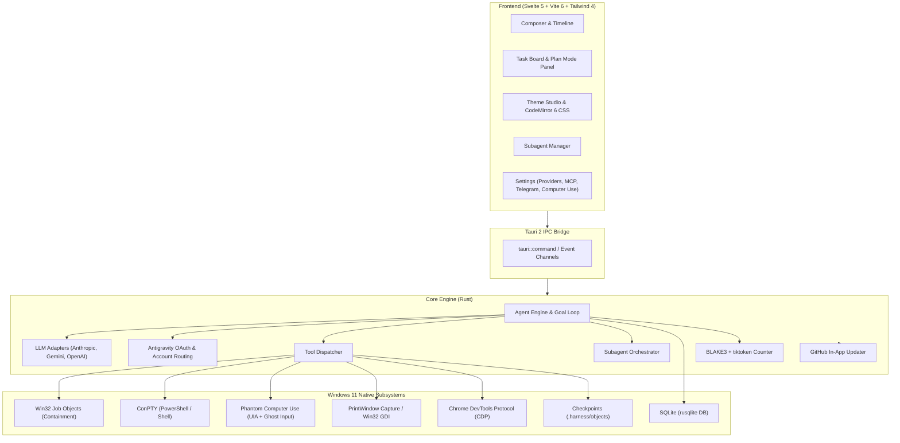

# OmniHarness

[](https://github.com/wasrecordrecorder/omni-harness/releases)
[](LICENSE)
[](https://github.com/wasrecordrecorder/omni-harness)
[](https://tauri.app/)
[](https://www.rust-lang.org/)
[](https://svelte.dev/)
[](https://tailwindcss.com/)

**OmniHarness** is a high-performance, autonomous AI-agent desktop harness engineered natively for Windows 11. Built with **Tauri 2**, **Rust**, and **Svelte 5**, it provides an execution runtime for autonomous LLM agents with system-level control, Win32 process containment, non-intrusive phantom desktop computer use, multi-provider OAuth account routing, and structured human-in-the-loop task boards.

---

## Key Features

### 1. Phantom Computer Use (Non-Intrusive Desktop Automation)
- **Zero Cursor & Focus Theft**: Automate Windows applications silently in the background without stealing user mouse focus or hijacking active input.
- **Off-Screen Staging & Isolated Desktops**: Launch target applications off-screen (`offscreen=true`) or dispatch them into an isolated Win32 desktop (`OmniPhantomDesktop`).
- **COM UIAutomation (UIA) Engine**: Inspect element trees via `snapshot_ui` and perform deterministic operations (`invoke`, `set_value`, `toggle`, `select`, `expand`, `collapse`, `scroll`).
- **Ghost Input**: Synthetic window-relative mouse and keyboard simulation (`click`, `double_click`, `right_click`, `drag`, `scroll`, `type`, `hotkey`) normalized to `0..1000` coordinate space.
- **Occluded & Background Window Capture**: High-speed window capture powered by `PrintWindow` API with support for occluded windows and 1:1 zoom crop screenshots.

### 2. Multi-Provider LLM Engine & Smart Account Routing
- **Antigravity OAuth Client (v2.32.1)**: Multi-account token pooling with automated refresh, plan tier detection (`Free`, `Pro`, `Ultra`), and quota rotation.
- **Model-Aware Account Routing**: Automatically selects accounts with granted entitlements for requested models (Gemini 3.8 Flash/Pro, Claude 3.5 Sonnet, GPT-4o, OpenAI o1/o3).
- **Anthropic Claude**: Full streaming tool use, prompt caching (`cache_control`), and multi-turn compaction.
- **Google Gemini**: Native streaming, thinking budget configuration, multimodal vision, and native image generation (`generate_image`).
- **OpenAI & Compatible Endpoints**: Full support for Chat Completions, Structured Outputs, DeepSeek, OpenRouter, and local inference runtimes (vLLM, Ollama).
- **Token Counter & Cache**: Real-time token tracking backed by `tiktoken-rs` and BLAKE3 hash caching in SQLite.

### 3. Subagent Hierarchical Architecture & Manager
- **Claude-Code Style Delegation**: Dispatch isolated subagents (`Explore`, `Plan`, `verification`, `general-purpose`, or `custom`) with dedicated context windows.
- **Parallel Dispatch**: Run multiple subagents concurrently within a single turn.
- **Visual Subagent Manager**: Built-in UI tab to create, edit, lint, test, and manage custom agent profiles (`.omni/agents/*.md`).

### 4. Comprehensive Tool Ecosystem
- **Atomic File Operations**: `read_file`, `edit_file`, `write_file`, and `patch_file` with SHA-256 integrity validation, unified diff support, and trash-backed deletion.
- **Workspace Discovery**: High-speed regex `grep`, glob search, and `code_intel` supporting AST symbol extraction and compiler diagnostics (`cargo check`, `svelte-check`, `tsc`).
- **ConPTY Terminal Streaming & Containment**: Real pseudoterminal (PTY) execution via `terminal_exec` and `terminal_io` with Win32 Job Object containment (`JOB_OBJECT_LIMIT_KILL_ON_JOB_CLOSE`).
- **Browser Automation (CDP)**: Headless web preview inspection, console error capturing, and screenshots via Chrome DevTools Protocol (`inspect_preview`).
- **Cross-Chat Inspection**: Query conversation history and inspect workspaces across sessions via `cross_chat`.
- **State Checkpoints & Snapshot Rewind**: Content-addressed Git-like checkpointing (`.harness/objects`) for instant workspace rollback.

### 5. Structured Task Contracts & Plan Mode
- **Task Board / Todo Contract**: Interactive visual widget for tracking multi-step execution states (`pending`, `in_progress`, `completed`, `failed`).
- **Plan Mode**: Read-only exploration mode ensuring architectural alignment and explicit plan confirmation before file modifications.

### 6. Theme Studio & Live 1:1 Preview
- **In-App Theme Designer**: Built-in Theme Studio featuring a CodeMirror 6 CSS editor, accent palettes, and typography controls.
- **Live 1:1 Preview**: Real-time sandbox rendering changes against live mock components before applying.
- **Rich Media & Formatting**: Inline LaTeX math rendering via KaTeX, interactive visual cards (`InteractiveVizCard`), inline audio/video playback, and color highlighters.

### 7. In-App GitHub Updater
- **Automated Update Detection**: Periodically polls GitHub Releases API for new releases.
- **One-Click Update**: Downloads the latest release archive in the background, extracts binaries, swaps `omni-harness.exe` and `WebView2Loader.dll`, and restarts the application seamlessly.

### 8. Model Context Protocol (MCP) & Skills
- **MCP Client**: Client catalog for connecting and multiplexing external Model Context Protocol servers.
- **Extensible Skills**: Automatic discovery and prompt injection of workspace and local skills (`.omniharness/skills`).

### 9. Persistent SQLite Memory & Disk Settings
- **Embedded SQLite Storage**: `rusqlite` database persisting chat history, session state, key pools, and long-term memory entries (`memory_tool`).
- **Project Source of Truth**: External Markdown summaries (`project_summary`) stored in `%LOCALAPPDATA%\OmniHarness\`.
- **Disk Persistence**: Application configuration saved to disk (`settings.json`).

### 10. Remote Telegram Bridge
- Remote interaction bridge supporting prompts, status updates, tool streaming, interactive UI menus, and media chunk distribution.

---

## Architecture Overview



---

## Project Structure

```
omni-harness/
├── .github/
│   └── workflows/
│       ├── ci.yml                     # Continuous integration workflow
│       ���── release.yml                # Automated Windows x64 release packaging
├── public/                            # Static assets and icons
├── src/                               # Svelte 5 frontend
│   ├── components/                    # UI Components
│   │   ├── settings/                  # Settings tabs (Providers, MCP, Telegram, etc.)
│   │   ├── themes/                    # Theme Studio, CodeMirror 6 editor, Mock Preview
│   │   ├── ChatView.svelte            # Chat timeline & streaming view
│   │   ├── Composer.svelte            # Agent input composer
│   │   ├── TaskBoardWidget.svelte     # Step-by-step task board
│   │   └── TodoContractPanel.svelte   # Plan mode & task contracts
│   ├── lib/                           # Stores, IPC commands, Markdown, tools
│   ├── App.svelte                     # Main application layout & updater banner
│   └── main.ts                        # Frontend entry point
├── src-tauri/                         # Rust backend
│   ├── src/
│   │   ├── db/                        # SQLite schema, migrations, memory, settings
│   │   ├── engine/                    # Agent loop, subagents, context compaction, task contracts
│   │   ├── llm/                       # Adapters, Antigravity OAuth client, account routing
│   │   ├── mcp/                       # Model Context Protocol client
│   │   ├── scheduler/                 # Autonomous goal scheduler & debate swarm
│   │   ├── skills/                    # Skills catalog and prompt injection
│   │   ├── speech/                    # Speech-to-text integration
│   │   ├── telegram/                  # Telegram bot bridge & media distribution
│   │   ├── tools/                     # Phantom Computer Use, ConPTY, workspace tools
│   │   │   ├── desktop_uia.rs         # Win32 COM UIAutomation bridge
│   │   │   ├── ghost_input.rs         # Background ghost mouse & keyboard input
│   │   │   ├── phantom_session.rs     # Off-screen desktop & window staging
│   │   │   └── process_pty.rs         # ConPTY pseudoterminal streaming
│   │   ├── updater.rs                 # In-app GitHub release updater
│   │   ├── themes.rs                  # CSS themes and variable injection
│   │   ├── lib.rs                     # Tauri command declarations & app setup
│   │   └── main.rs                    # Application entry point
│   ├── Cargo.toml                     # Rust dependencies and release profiles
│   └── tauri.conf.json                # Tauri 2 configuration
├── package.json                       # Frontend dependencies & build scripts
├── tsconfig.json                      # TypeScript configuration
└── vite.config.ts                     # Vite bundler configuration
```

---

## Getting Started

### Prerequisites

- **Windows 11 x64**
- **Node.js**: `v20.x` or later (LTS recommended)
- **Rust Toolchain**: `stable-x86_64-pc-windows-msvc` (1.80+)
- **Build Tools**: Microsoft C++ Build Tools (MSVC)
- **Microsoft Edge WebView2**: Runtime installed (pre-installed on Windows 11)

### Installation

1. **Clone the repository:**
   ```bash
   git clone https://github.com/wasrecordrecorder/omni-harness.git
   cd omni-harness
   ```

2. **Install frontend dependencies:**
   ```bash
   npm install
   ```

3. **Verify type definitions and code health:**
   ```bash
   npm run check
   ```

---

## Development & Building

### Run in Development Mode
Starts the Vite dev server at `http://localhost:1420` and launches the Tauri window:
```bash
npx tauri dev
```

### Build for Production
Creates the optimized release binary with ThinLTO and stripped symbols:
```bash
# 1. Build frontend distribution
npm run build

# 2. Compile release binary
npx tauri build
```

The output artifacts are generated at:
- `src-tauri/target/release/omni-harness.exe`
- `src-tauri/target/release/WebView2Loader.dll` *(must remain adjacent to the executable)*

---

## Automated CI/CD Releases (GitHub Actions)

The workflow [`.github/workflows/release.yml`](.github/workflows/release.yml) automatically compiles and publishes production packages:

1. **Trigger via Git Tag**:
   ```bash
   git tag v1.0.4
   git push origin v1.0.4
   ```

2. **Trigger via Web UI (Manual)**:
   Navigate to **Actions** -> **Release Build** -> **Run workflow**.

Each release automatically produces:
- `OmniHarness-v<version>-win64.zip` (standalone archive with `omni-harness.exe`, `WebView2Loader.dll`, `README.md`, and `LICENSE`)
- Raw `omni-harness.exe`
- Raw `WebView2Loader.dll`
- `checksums.txt` (SHA-256 hashes)
- Automated publication to GitHub Releases.

---

## Configuration & Storage

OmniHarness stores local configuration, credentials, and databases in:
`%LOCALAPPDATA%\OmniHarness\`

- `omni_harness.db`: SQLite database for chats, message history, token caches, and long-term memory.
- `settings.json`: UI and system preferences (updater, appearance, models).
- `providers_snapshot.json`: Configured LLM providers and API keys.
- `workspaces_snapshot.json`: Workspace paths and permissions.
- `telegram_config.json`: Telegram bridge configuration.

---

## License

This project is licensed under the [MIT License](LICENSE).
