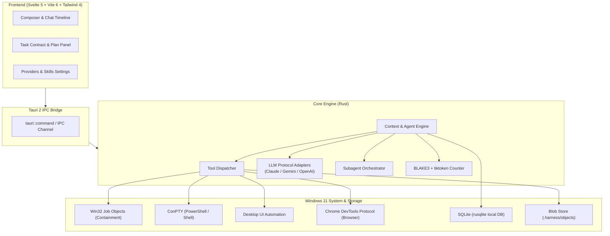

# OmniHarness

[](LICENSE)
[](https://github.com/wasrecordrecorder/omni-harness)
[](https://tauri.app/)
[](https://www.rust-lang.org/)
[](https://svelte.dev/)
[](https://tailwindcss.com/)

**OmniHarness** is a high-performance, autonomous AI-agent desktop harness engineered natively for Windows 11. Built with **Tauri 2**, **Rust**, and **Svelte 5**, it provides an execution runtime for autonomous LLM agents with full system access, process containment, multi-model support, and structured human-in-the-loop controls.

---

## Key Features

### 1. Windows 11 Native Runtime & Safety
- **Win32 Job Objects**: Strict process tree containment with `JOB_OBJECT_LIMIT_KILL_ON_JOB_CLOSE` ensures that spawned build tasks, test runners, or runaway processes are terminated cleanly upon session completion.
- **ConPTY Terminal Streaming**: Real pseudoterminal (PTY) execution with bidirectional I/O, live terminal log streaming, and background process management.
- **Windows UI Automation (UIA)**: Native Win32 desktop and accessibility automation bridge.
- **Frameless Window**: Custom dark-themed titlebar and native window controls.

### 2. Multi-Provider LLM Engine
- **Anthropic Claude**: Full streaming tool use, prompt caching (`cache_control`), and multi-turn conversation compaction.
- **Google Gemini**: Native streaming, thinking budget allocation, and multimodal vision support.
- **OpenAI & Compatible Endpoints**: Support for Chat Completions, Structured Responses, DeepSeek, OpenRouter, and local models (vLLM, Ollama).
- **Token Counter & Cache**: Local `tiktoken` counting backed by BLAKE3 hash caching in SQLite to track context consumption in real time.

### 3. Comprehensive Tool Ecosystem
- **Atomic File Operations**: `read_file`, `edit_file`, `write_file`, and `patch_file` with SHA-256 pre/post integrity hashing, unified diff support, and trash-backed deletion.
- **Workspace Discovery**: High-speed regex `grep`, glob search, and `code_intel` supporting AST symbol extraction and compiler diagnostics (`cargo check`, `svelte-check`, `tsc`).
- **Interactive Terminal & Background PTY**: `terminal_exec` and `terminal_io` with configurable timeouts and pattern matching on process output.
- **Browser Automation & Preview Inspection**: Built-in Chrome DevTools Protocol (CDP) client for headless preview verification, console error capturing, and screenshots.
- **State Checkpoints & Snapshot Rewind**: Content-addressed Git-like checkpointing (`.harness/objects`) for instant workspace state rewind and conflict mitigation.

### 4. Subagent Hierarchical Architecture
- **Claude-Code Style Delegation**: Dispatch isolated subagents (`Explore`, `Plan`, `verification`, `general-purpose`, or `custom`) with isolated context windows.
- **Parallel Dispatch**: Execute multiple subagents concurrently within a single turn.

### 5. Structured Task Contracts & Plan Mode
- **Task Board / Todo Contract**: Interactive visual panel for multi-step task tracking (`pending`, `in_progress`, `completed`, `failed`).
- **Plan Mode**: Read-only exploration mode ensuring architectural alignment before file modifications.

### 6. Model Context Protocol (MCP) & Skills
- **MCP Client**: Dynamic client catalog for connecting external Model Context Protocol servers.
- **Extensible Skills**: Automatic discovery and prompt injection of workspace and local skills (`.omniharness/skills`).

### 7. Persistent SQLite Memory
- Embedded SQLite (`rusqlite` bundled) storing conversation histories, session artifacts, key pools, and long-term memory entries across sessions.

### 8. Remote Telegram Bridge
- Built-in bidirectional Telegram bot bridge (`@impact_hermes_bot`) supporting remote prompts, status updates, and chunked binary distribution.

---

## Architecture Overview



---

## Project Structure

```
omni-harness/
├── .github/
│   └── workflows/
│       └── ci.yml               # GitHub Actions CI for Svelte & Rust
├── public/                      # Static assets & icons
├── src/                         # Svelte 5 frontend
│   ├── components/              # UI components (Composer, Timeline, Task Contract)
│   ├── lib/                     # Stores, IPC helpers, Markdown parser, tool mappers
│   ├── App.svelte               # Root Svelte application
│   └── main.ts                  # Frontend entry point
├── src-tauri/                   # Rust backend
│   ├── src/
│   │   ├── db/                  # SQLite schema, migrations, memory entries
│   │   ├── engine/              # Single agent, subagents, context compaction, task contracts
│   │   ├── llm/                 # Provider adapters (Anthropic, Gemini, OpenAI, Token counter)
│   │   ├── mcp/                 # Model Context Protocol client & catalog
│   │   ├── skills/              # Skills catalog and prompt injection
│   │   ├── speech/              # Speech-to-text engine
│   │   ├── state/               # Application state snapshots
│   │   ├── telegram/            # Remote Telegram bot bridge
│   │   ├── tools/               # Tool implementations (PTY, workspace, browser, safety, blob store)
│   │   ├── lib.rs               # Tauri entrypoint & command declarations
│   │   └── main.rs              # Application main
│   ├── Cargo.toml               # Rust dependencies and release profiles
│   └── tauri.conf.json          # Tauri configuration (CSP, window, capabilities)
├── AGENTS.md                    # Project memory and build specifications
├── package.json                 # Node dependencies and build scripts
├── tsconfig.json                # TypeScript configuration
└── vite.config.ts               # Vite bundler configuration
```

---

## Getting Started

### Prerequisites

- **Windows 11 x64**
- **Node.js**: `v20.x` or later (LTS recommended)
- **Rust Toolchain**: `stable-x86_64-pc-windows-msvc` (1.80+)
- **Build Tools**: Microsoft C++ Build Tools or MinGW-w64
- **Microsoft Edge WebView2**: Runtime installed (pre-installed on Windows 11)

### Installation

1. **Clone the repository:**
   ```bash
   git clone https://github.com/wasrecordrecorder/omni-harness.git
   cd omni-harness
   ```

2. **Install frontend dependencies:**
   ```bash
   npm install
   ```

3. **Verify type definitions and code health:**
   ```bash
   npm run check
   ```

---

## Development & Building

### Run in Development Mode
Starts the Vite dev server at `http://localhost:1420` and launches the Tauri window:
```bash
npx tauri dev
```

### Build for Production
Creates the optimized release binary with ThinLTO and symbol stripping:
```bash
# 1. Build frontend distribution
npm run build

# 2. Compile release binary
npx tauri build
```

The output artifacts are generated at:
- `src-tauri/target/release/omni-harness.exe`
- `src-tauri/target/release/WebView2Loader.dll` *(must remain adjacent to the executable)*

### Automated CI/CD Releases (GitHub Actions)

A dedicated workflow [`.github/workflows/release.yml`](.github/workflows/release.yml) automatically builds and publishes the production package:

1. **Trigger via Git Tag**:
   ```bash
   git tag v1.0.0
   git push origin v1.0.0
   ```
2. **Trigger via Web UI (Manual)**:
   Navigate to **Actions** -> **Release Build** -> **Run workflow** (specify tag, draft or prerelease status).

Each release workflow automatically outputs:
- `OmniHarness-<version>-win64.zip` (standalone archive containing `omni-harness.exe`, `WebView2Loader.dll`, `README.md`, and `LICENSE`)
- Raw `omni-harness.exe`
- Raw `WebView2Loader.dll`
- `checksums.txt` (SHA-256 integrity hashes)
- GitHub Actions artifact storage (retained for 30 days) and automated GitHub Releases.

---

## Configuration

OmniHarness persists local data, credentials, and settings inside:
`%LOCALAPPDATA%\OmniHarness\`

- `omni_harness.db`: SQLite database for chats, memory, and token cache.
- `providers_snapshot.json`: Configured LLM providers and API keys.
- `workspaces_snapshot.json`: Workspace paths and access permissions.
- `telegram_config.json`: Remote Telegram bot settings.

---

## License

This project is licensed under the [MIT License](LICENSE).
